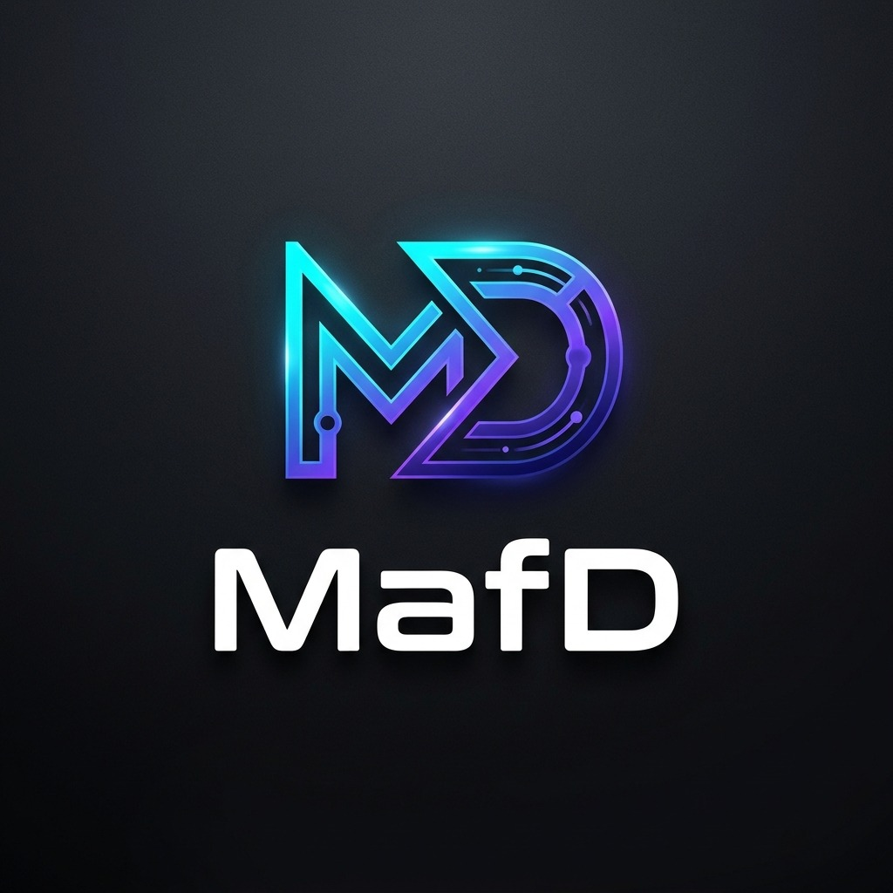

<div align="center">



# MafD

### Universal Video & Audio Downloader for Android

[](https://android.com)
[](LICENSE)
[](https://github.com/yt-dlp/yt-dlp)

**MafD** is a modern, fast, and privacy-focused Android application designed to download videos and audio from virtually any public platform without requiring account logins.

[Features](#-features) • [Installation](#-installation) • [How to Use](#-how-to-use) • [Building from Source](#-building-from-source)

</div>

---

## ✨ Features

- **Zero Login Friction**: Download public Instagram Reels, YouTube Shorts, YouTube Videos, and Facebook videos directly without signing in.
- **Multiple Video Resolutions**: Support for 1080p Full HD, 720p HD, 480p, and more in MP4 format.
- **High-Quality Audio Extraction**: Extract audio in MP3 format with configurable bitrates (320 kbps, 256 kbps, 128 kbps).
- **Background Foreground Service**: Heavy download and extraction tasks run securely inside an Android Foreground Service with status notifications, preventing system termination.
- **Modern Material You UI**: Clean, dynamic Material Design 3 interface with theme customization.
- **Embedded Metadata & Subtitles**: Automatically embed video thumbnails, subtitles, and chapter markers into media files.
- **Privacy-First**: No ads, no user tracking, no third-party telemetry. All downloads go directly to your device storage (`/Download/MafD`).

---

## 📥 Installation

1. Go to the **Releases** tab on GitHub.
2. Download the latest `MafD.apk`.
3. Open the downloaded file on your Android device and allow **Install from unknown sources** if prompted.
4. Launch **MafD** and start downloading!

---

## 🚀 How to Use

1. **Copy Link**: Copy any video or reel link from Instagram, YouTube, Facebook, or other supported sites.
2. **Open MafD**: Open the MafD app and paste the link into the URL input bar.
3. **Select Format**:
   - Choose **Video** (1080p, 720p, etc.)
   - Or choose **Audio** (MP3 320k, 256k, etc.)
4. **Download**: Tap download. The progress will appear in your notification shade and the completed file will be saved in your device's Downloads folder.

---

## 🛠 Building from Source

To compile **MafD** locally:

### Prerequisites
- JDK 17 or higher
- Android SDK (API 34 / 35)

### Steps
```bash
git clone <your-repo-url>
cd MafD
./gradlew assembleGenericDebug -PnoSplits
```
The compiled APK will be generated at:
`app/build/outputs/apk/generic/debug/MafD-*.apk`

---

## 📄 License

This project is licensed under the **GNU General Public License v3.0**. See the [LICENSE](LICENSE) file for details.
